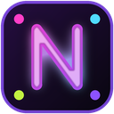

<p align="center"></p>

# Neon Suite: Gmail, WhatsApp, Slack e YouTube

**Neon Suite** é uma extensão só para Chrome e Edge que junta o GM Neon, o WP Neon, o SL Neon e o YT Neon. Ela dá tema neon e recursos extras ao Gmail, ao WhatsApp Web, ao Slack e ao YouTube.

**O menu abre conforme o site em que você está.** Clique no ícone da barra:
- no Gmail, abre o menu do Gmail;
- no YouTube, abre o do YouTube;
- em qualquer outro site, abre a página inicial com os quatro sites e uma cor para aplicar em todos de uma vez.

O ícone da barra também muda conforme o site da aba, na cor escolhida para ele.

> Projeto independente, sem relação com Google, Meta, Slack/Salesforce ou YouTube. Gmail e YouTube são marcas do Google LLC, WhatsApp da Meta e Slack da Slack Technologies, LLC.

## O que cada site ganha

| Site | Recursos |
|---|---|
| **Gmail** | Tema escuro neon, 6 cores, fundos animados, hover 3D que segue o mouse, compose neon, marcar tudo como lido (com confirmação) e modo discreto (Alt+P) |
| **WhatsApp Web** | Transcrição dos áudios recebidos **no seu PC** (Whisper local), tema neon com várias cores, fundos animados, efeitos 3D e fontes |
| **Slack** | Tema neon, fontes (Roboto Mono, Open Sans, Arial), fundos animados, **aviso neon de mensagens** com o Slack em foco e aviso do Windows com o ícone do tema e o botão "Abrir no Slack" |
| **YouTube** | **Player flutuante sempre por cima** (completo, com esticar, ou mínimo, sem barra), velocidade de 0,25x a 4x com memória por canal, volume até 400%, loop A-B, captura de frame, qualidade padrão, retomar de onde parou, modo foco, esconder Shorts e comentários, grade com colunas ajustáveis e atalhos editáveis |

Todos os sites têm a cor Bullet e o fundo "Bullet: balas e cripto".

## Preferências

- **Separadas por site:** a cor do Gmail não muda a do Slack. A página inicial tem "Cor em todos os sites" para igualar tudo de uma vez.
- **Em Opções:** backup de tudo (exportar/importar `.json`), restaurar o padrão de cada site e os atalhos do YouTube.
- **Anúncios e downloads:** o YouTube não tem anúncios alterados nem download de vídeo.

## Instalar (modo desenvolvedor)

1. Remova o GM Neon, o WP Neon, o SL Neon e o YT Neon, se estiverem instalados. Senão, o tema é aplicado duas vezes.
2. Baixe e descompacte `neon-suite-1.0.0.zip`.
3. Abra `chrome://extensions` e ligue o **Modo do desenvolvedor**.
4. Clique em **Carregar sem compactação** e escolha a pasta.
5. Recarregue os sites abertos.

As preferências das extensões antigas não passam para a Suite, então é só escolher de novo.

## Estrutura

```
manifest.json       um manifest para os quatro sites
background.js       service worker único: ícone por aba + background de cada site
ns.js               preferências por site (prefixo gmail:, whatsapp:, slack:, youtube:)
popup.*             abre o menu do site da aba; senão, a página inicial
options.*           backup e restaurar padrão
bullet-fx.js        fundo "Bullet: balas e cripto" (compartilhado)
fonts/              Open Sans e Roboto Mono (OFL)
sites/<site>/       código de cada site
```

Detalhes de privacidade em [PRIVACY.md](PRIVACY.md).
